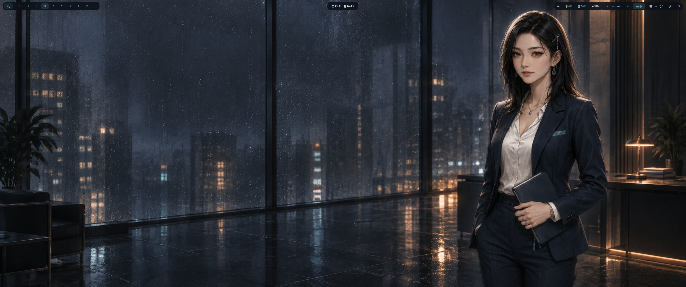
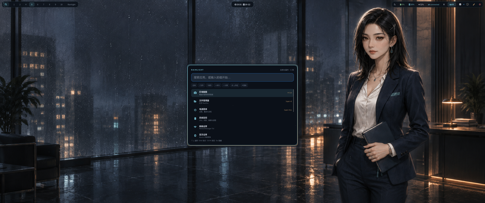
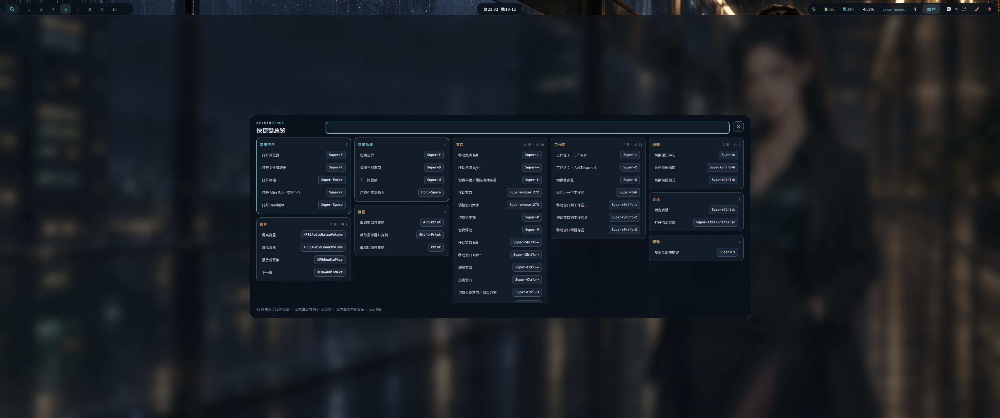

# 桌面截图

以下图片于 2026-10-12 从 3440×1440 Hyprland 实机会话截取，没有合成窗口或后期加雨。
雨滴模式为 `heavy`，渲染器是 `glass-droplets`。雨滴效果较细微，静态截图无法展示
水珠凝结和滑落的动画；壁纸本身也包含雨景。截图后已将雨滴模式恢复为原来的 `normal`。

## 雨中桌面

空工作区、林晚壁纸与顶部 Waybar。

## Rainlight

在同一雨景桌面上打开 Rainlight 启动器。

## 快捷键总览

在徐知安壁纸上打开运行态快捷键总览。

玻璃水珠的档位与运行状态见[效果说明](RAIN-EFFECTS.zh-CN.md)。
